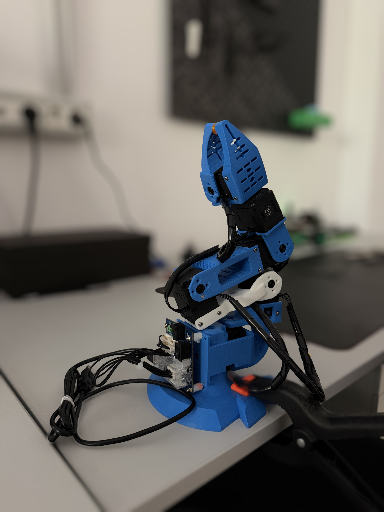

# JawPixARM 6-DOF Robotic Arm (ROS 2 Jazzy)

ROS 2 workspace for the **JawPixARM**, a 6-DoF robotic manipulator built with Dynamixel XL430-W250-T servos. A custom C++ hardware driver connects the servos to the ros2_control framework, and MoveIt 2 plans and executes trajectories on the real arm or on a simulated one.

<p align="center">
  
</p>

---

## Packages

| Package | Contents |
| --- | --- |
| `my_robot_description` | Robot model (URDF/xacro, STL meshes), ros2_control block, RViz layout, model viewer launch |
| `my_robot_hardware` | ros2_control hardware plugin and Dynamixel driver, homing tool, udev rule for the U2D2 |
| `my_robot_bringup` | Launch files for the real or simulated arm, controller settings |
| `my_robot_moveit_config` | MoveIt 2 configuration (SRDF, kinematics, limits, controllers) and launch files |

Joints: `joint1` base, `joint2` shoulder, `joint3` elbow, `joint4` wrist pitch, `joint5` wrist roll, `joint6` gripper. `arm_controller` drives joints 1-5, `gripper_controller` drives joint 6.

---

## Requirements

- Ubuntu 24.04, ROS 2 Jazzy
- U2D2 (USB to Dynamixel TTL) and U2D2 Power Hub
- **12 V power supply, at least 5 A** (regulated switching supply). A 2-3 A adapter cannot cover the current peaks of six servos: the voltage collapses and all servos reset together.

```bash
sudo apt update
sudo apt install ros-jazzy-ros2-control ros-jazzy-ros2-controllers ros-jazzy-moveit \
                 ros-jazzy-dynamixel-sdk ros-jazzy-xacro ros-jazzy-joint-state-publisher-gui \
                 ros-jazzy-rqt-joint-trajectory-controller python3-serial
```

### Build

```bash
cd ~/ros2_ws
colcon build --symlink-install
source install/setup.bash
```

With `--symlink-install`, changes to launch, YAML, xacro and SRDF files apply at the next launch without rebuilding. Changes to the C++ driver need `colcon build` again.

---

## One-time setup

### 1. udev rule for the U2D2

Sets the USB latency timer to 1 ms (Linux default is 16 ms, which causes "Overrun" warnings), gives everyone read/write access to the port and creates the alias `/dev/u2d2`. It replaces the old `chmod 666` and `setserial low_latency` commands, which had to be repeated after every replug.

```bash
sudo cp ~/ros2_ws/src/my_robot_hardware/udev/99-u2d2.rules /etc/udev/rules.d/
sudo udevadm control --reload-rules && sudo udevadm trigger
# unplug and replug the U2D2, then check:
cat /sys/bus/usb-serial/devices/ttyUSB0/latency_timer   # must print 1
```

### 2. Homing offsets

The driver reads absolute positions from the servo encoders, so every servo must read 2048 ticks (0 rad) in the URDF zero pose. The offsets are stored in the servos and survive power-off. Repeat only after reassembling the arm or replacing a servo.

1. Stop ROS, so the serial port is free.
2. Hold the arm in the URDF zero pose: base facing forward, upper arm about 23° forward of vertical, forearm and wrist horizontal and in line, gripper level, moving jaw at 90° to the fixed jaw. RViz shows this pose when all joints are 0.
3. Run:

```bash
python3 ~/ros2_ws/src/my_robot_hardware/tools/set_homing.py --show   # current angles, changes nothing
python3 ~/ros2_ws/src/my_robot_hardware/tools/set_homing.py          # writes the offsets
```

After writing, every joint should read about 0°. If `import serial` or `import dynamixel_sdk` fails (for example inside a conda environment), run `python3 -m pip install pyserial dynamixel-sdk` or `conda deactivate`.

---

## Every session

1. Connect the 12 V supply to the Dynamixel Power Hub.
2. Connect the U2D2 to the computer (laptop, PC or Raspberry Pi 5).
3. On a VM: connect the U2D2 to the Linux guest (VMware: Virtual Machine > Removable Devices > Connect).
4. Source the workspace in every new terminal: `source ~/ros2_ws/install/setup.bash`

---

## Startup calibration

Every launch with the real arm runs a calibration inside the driver before the controllers start: the arm moves to `home`, then to `idle` (all joints 0), at 0.5 rad/s peak speed. The arm can start from any pose. The terminal shows:

```
[MobileBaseHardware]: Calibration: waiting for home ...
[MobileBaseHardware]: Calibration: home done (...)
[MobileBaseHardware]: Calibration: waiting for idle ...
[MobileBaseHardware]: Calibration: idle done (...)
[MobileBaseHardware]: Calibration complete. Controllers start now.
```

The first move goes straight from the current pose to `home` without obstacle checking, so start with the arm clear of the desk. A blocked joint stops the move within a few seconds and the log names it.

Settings, all optional, inside `<hardware>` in `my_robot_description/urdf/my_robot.ros2_control.xacro`:

```xml
<param name="calibrate_on_start">false</param>            <!-- skip the calibration -->
<param name="calibration_velocity">0.5</param>            <!-- peak speed, rad/s -->
<param name="calibration_home">0 -1.5707 -1.5707 -1.5707 0 0</param>
<param name="calibration_idle">0 0 0 0 0 0</param>
```

Joints 3 and 4 are mounted opposite to their URDF axes and are reversed in the driver by default (the startup table shows `reversed`). A `<param name="direction">1</param>` or `-1` inside a `<joint>` block of the same xacro overrides the default for that joint.

---

## Controlling the arm

### Method 1: trajectory topic

```bash
ros2 launch my_robot_bringup my_robot.launch.xml                          # real arm
ros2 launch my_robot_bringup my_robot.launch.xml use_mock_hardware:=true  # simulated arm
```

In a second terminal:

```bash
# arm (joints 1-5)
ros2 topic pub --once /arm_controller/joint_trajectory trajectory_msgs/msg/JointTrajectory "{
  joint_names: ['joint1', 'joint2', 'joint3', 'joint4', 'joint5'],
  points: [{positions: [0.2, 0.2, 0.2, 0.0, 0.0], time_from_start: {sec: 2}}]
}"

# gripper (joint 6): 0.0 open, -1.84 closed
ros2 topic pub --once /gripper_controller/joint_trajectory trajectory_msgs/msg/JointTrajectory "{
  joint_names: ['joint6'],
  points: [{positions: [-1.0], time_from_start: {sec: 2}}]
}"
```

### Method 2: GUI sliders

With `my_robot.launch.xml` running:

```bash
ros2 run rqt_joint_trajectory_controller rqt_joint_trajectory_controller
```

Select `controller_manager` and `arm_controller` (or `gripper_controller`), press the power button and move the sliders.

`joint_state_publisher_gui` does not move the arm: it only publishes fake joint states for viewing the model, and it conflicts with the real joint states. Use it only with the model viewer below.

### Method 3: MoveIt

```bash
# simulated arm, nothing connected
ros2 launch my_robot_moveit_config demo.launch.py

# real arm: driver + startup calibration + controllers + MoveIt + RViz
ros2 launch my_robot_bringup my_robot_moveit.launch.xml
```

In the RViz MotionPlanning panel:

1. Set **Velocity Scaling** and **Acceleration Scaling** to 0.1-0.2.
2. Planning group `arm`: choose a goal (named state `home` / `idle`, the **Joints** tab, or drag the marker between the jaws), then **Plan** and **Execute**.
3. Planning group `gripper`: named states `open` and `closed`.

The arm has 5 joints, so the IK solver targets the position of the gripper (`tcp_link`) only; the orientation follows from the arm.

### Model viewer only (no controllers, no hardware)

```bash
ros2 launch my_robot_description display.launch.xml
```

---

## Troubleshooting

| Message or symptom | Cause and fix |
| --- | --- |
| `<-- OUTSIDE THE URDF LIMITS` and `Torque stays off` with calibration off | Homing offsets not set, or a joint really outside its range. Run the homing tool, or enable the calibration. |
| `cannot open /dev/ttyUSB0` | U2D2 not connected (to the VM), another program uses the port, or the udev rule is missing. |
| `Servo ID N does not answer` | Wiring, power, ID or baud rate of that servo. |
| `USB latency timer is 16 ms` / `Overrun might occur` | udev rule not active: install it and replug the U2D2. |
| `There is no status packet!` and all six servos stop answering at once, usually with the arm stretched out | Power supply too weak: the voltage collapses under load. Use 12 V at least 5 A and feed power through the Power Hub. Restart the launch after the servos are powered again. |
| `Servo ID N stopped itself: Overload` | That servo is blocked or overloaded. Avoid fully stretched poses with load. |
| Execute fails with `Didn't receive robot state` | `ros2_control_node` died at startup: read the `MobileBaseHardware` lines just above its stack trace. |
| RViz cannot draw the arm (`Fixed Frame does not exist`) | Set Fixed Frame to `base_link`. |
